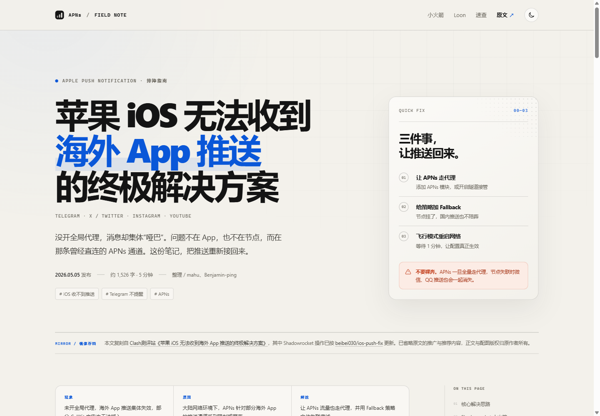

# Apple APNs Proxy

> 当 iPhone 上的 Telegram、X、Instagram 集体“哑巴”，把 APNs 接回代理链路。

一个排版精致的静态文章镜像，复刻自 Clash测评站：

**[苹果 iOS 无法收到海外 App 推送（TelegramXIG）的终极解决方案](https://mahu.blog/article/applepushquestion/)**

文章梳理了 iOS 海外 App 推送失效的原因，并给出 Shadowrocket、Loon 与精简规则三套 APNs 接管方案。其中 Shadowrocket 部分已按 [beibei030/ios-push-fix](https://github.com/beibei030/ios-push-fix) 更新为模块 / 完整配置两种方式。本项目将内容整理为可离线阅读的单页站点，补上了目录、代码复制、阅读进度与深色模式。

## 预览



## 内容

- **核心思路**：让 APNs 流量走代理，同时用 Fallback 策略防止节点故障导致“全设备失联”。
- **方案一 · Shadowrocket**：使用 `APNs_Push_Fix.sgmodule` 模块（推荐），或导入完整配置订阅；在隧道中打开 APNs，飞行模式重启后重连 VPN。
- **方案二 · Loon**：创建 `fallback` 策略组、添加远程规则、接管系统路由。
- **方案三 · 精简规则**：只代理 `push.apple.com`、`akadns.net` 等核心域名与 `17.0.0.0/8`。
- **额外提示**：蜂窝网络下的 APNs 接管、Telegram 第三方客户端、非国行设备与漫游网络。
- **一页速查**：根据原文整理的排障索引。

## 本地预览

这是一个无构建步骤的静态站点，直接用任意静态服务器打开即可：

```bash
# Python 3
python -m http.server 8080

# 或 Node.js
npx serve .
```

然后访问 <http://localhost:8080>。

> 直接双击 `index.html` 也能阅读，但浏览器可能限制 `file://` 下的剪贴板权限；通过本地服务器访问可获得完整功能。

## 部署到 GitHub Pages

1. 打开仓库的 **Settings → Pages**。
2. 在 **Build and deployment** 中选择 **Deploy from a branch**。
3. 分支选择 `main`，目录选择 `/ (root)`，保存。
4. 稍等片刻，访问 `https://<你的用户名>.github.io/Apple-APNs-Proxy/`。

## 项目结构

```text
Apple-APNs-Proxy/
├── .gitattributes              # 统一 LF 换行
├── .gitignore
├── index.html                  # 文章页面
├── assets/
│   ├── app.js                  # 主题、复制、进度条、目录高亮
│   ├── styles.css              # 页面样式
│   ├── favicon.svg             # 站点图标
│   ├── apple-push-tunnel.png   # 配图：Shadowrocket 隧道设置
│   └── preview.png             # 页面预览图
└── README.md
```

## 来源与版权

- 原文：[苹果 iOS 无法收到海外 App 推送（TelegramXIG）的终极解决方案](https://mahu.blog/article/applepushquestion/)
- 站点：Clash测评站 · [mahu.blog](https://mahu.blog/)
- 发布：2026 年 5 月 5 日
- 贡献者：mahu、Benjamin-ping
- Shadowrocket 操作参考：[beibei030/ios-push-fix](https://github.com/beibei030/ios-push-fix)

**正文、配图及观点版权归原作者与 Clash测评站所有。** Shadowrocket 模块与配置由 `ios-push-fix` 仓库维护，相关规则版权归其作者所有。本仓库仅作技术资料存档，未包含原文的推广与推荐链接。如有侵权，请通过 Issue 联系删除。

页面代码（HTML / CSS / JavaScript）可自由参考用于学习，但不得用于移除或模糊原文署名后二次发布。
